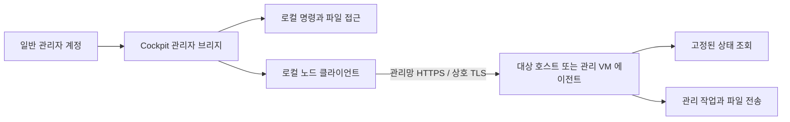

# 일반 관리자 계정 및 노드 통신 전환

Cockpit은 일반 계정으로 로그인하고 관리자 접근을 활성화합니다. 화면의 명령 실행,
스크립트, 설정 파일 접근은 공통 `src/common/privileged.js`에서
`superuser: "require"`를 사용합니다. 권한 상승을 허용하지 않는 계정은 작업을 실행할
수 없으며, 권한 상승 실패 시 일반 계정 권한으로 재시도하지 않습니다.
계정 이름으로 권한을 판단하거나 sudo 비밀번호를 코드에 저장하지 않습니다.

RHEL 계열에서는 기존 관리자 계정을 `wheel` 그룹에 추가하고 해당 계정의 sudo
정책을 설정합니다. 예를 들어 계정 이름이 `sudore`라면 다음을 실행합니다.

```sh
sudo usermod -aG wheel sudore
```

그룹 변경 후 다시 로그인하고 Cockpit 상단의 **관리자 접근**을 활성화합니다.
계정에는 필요한 시스템 관리 작업을 수행할 sudo 권한이 있어야 합니다.
이 변경은 sudoers나 Polkit의 인증 정책을 완화하지 않습니다.

## 통신 구조



일상 조회·관리 요청에서는 로컬 관리자 브리지가 root 전용 설정과 노드별 인증서를
읽어 대상에 연결합니다. 최초 등록에서는 관리자에게 해당 호스트용 키가 포함된
등록 파일을 다운로드·업로드하게 하며, 비밀키를 일반 `cluster.json`에 넣지 않습니다.
에이전트는 관리 IP의 TCP 9445를
사용하며 설정에서 포트를 변경할 수 있습니다. `0.0.0.0`/`::` 전체 인터페이스
바인딩은 허용하지 않습니다. 노드의 기존 Glue/PowerFlex API는 계속 사용합니다.

다음 조건을 모두 충족해야 원격 요청을 허용합니다.

- 전용 CA가 서명한 유효한 클라이언트/서버 인증서
- 서버 주소와 인증서 SAN 일치
- 서버의 `peers`에 등록한 클라이언트 인증서 SHA-256 지문
- 요청에 맞는 `reader` 또는 `admin` 역할
- 클라이언트의 `nodes`에 등록한 대상 주소/별칭

`reader`는 health와 등록된 상태 조회만 사용할 수 있습니다. `admin`은 기존
배포·스토리지·클러스터 관리 작업을 위해 명령 실행과 파일 전송을 사용할 수
있습니다. **admin 노드 인증서는 대상의 root 관리 권한과 동등**하므로 해당
비밀키와 CA 비밀키를 구분하여 관리합니다. 인증 실패 시 SSH로 전환하지 않습니다.

기존 복잡한 배포 스크립트는 명령 인자와 셸 동작을 유지하는 전송 어댑터를
통해 실행합니다. 어댑터에 남아 있는 `root@host`, `StrictHostKeyChecking` 등의
기존 호출 형식은 호환용 입력이며 SSH 로그인이나 TLS 검증 해제를 수행하지 않습니다.
새 코드는 가능한 한 인자 배열과 명시적인 조회 API를 사용합니다.

## 조회의 영향

SCVM/PFMP/CCVM의 디스크·게이트웨이·DNS·서비스 상태는 고정된 snapshot API로
수집합니다. cloud-init 상태와 노드 연결 여부도 별도 조회를 사용합니다.
조회 API에는 셸 명령이나 실행 인자를 전달할 수 없습니다.

조회는 서비스 시작/재시작, 설정 파일 쓰기, 패키지 설치, SSH 키 스캔을 하지
않습니다. 페이지를 열 때 기존 `known_hosts`를 갱신하거나 클러스터 설정을
자동으로 덮어쓰던 동작도 제거했습니다. 조회 자체의 CPU·디스크 읽기·네트워크
비용은 있으며, 5초 캐시·명령별 제한 시간·동시 요청 수 제한으로 부하를 제한합니다.
디스크 snapshot은 로컬 파일시스템만 조회하여 NFS/Ceph 마운트의 용량 조회를 피합니다.
에이전트 연결 장애가 발생해도 대상 서비스를 복구하려고 변경 작업을 실행하지 않습니다.

## 빌드 및 배포 순서

`tools/makerpm/rpmbuild.sh`는 두 패키지를 만듭니다.

| 패키지 | 설치 대상 |
| --- | --- |
| `ablecube-<version>-<release>.x86_64.rpm` | Cockpit 플러그인을 사용하는 호스트/SCVM |
| `ablecube-agent-<version>-<release>.noarch.rpm` | 통신 대상 전체 호스트와 CCVM/SCVM/GWVM/PFMP 등 관리 VM |

RPM 패키지 이름은 `ablecube-agent`, systemd 서비스 이름은 `cube-agent.service`입니다.
서비스 상태와 로그는 다음 명령으로 확인합니다.

```sh
systemctl status cube-agent.service
journalctl -u cube-agent.service
```

에이전트는 Python 3.9 이상과 OpenSSL 1.1.1 이상을 사용하며 외부 Python 패키지는
필요하지 않습니다. 플러그인 RPM은 동일 버전의 에이전트 RPM을 요구합니다.
RPM은 첫 부팅/네트워크 연결 후 설치 자료를 확인하는 초기화 서비스를 등록합니다.
신뢰할 인증서 번들이 준비되지 않은 기본 `member` 모드에서는 대기하며,
인증서 없이 에이전트 포트를 열지 않습니다.

## 공통 Kickstart와 클러스터 구성 준비

실제 설치 순서는 공통 Kickstart로 각 Cube 설치 → 설치 시 지정한 IP로 Cockpit 로그인
→ 브리지 네트워크 구성 → 각 호스트의 클러스터 구성 준비입니다. 최초 root 로그인과
이후 일반 sudo 관리자 로그인을 모두 지원합니다. 동일 Kickstart에는 두 RPM과 기본
`member` 설정을 설치하며 CA, 노드 비밀키, 특정 발급 노드 역할을 미리 넣지 않습니다.
첫 부팅에 인증서가 없어 에이전트가 대기하는 것은 이 흐름에서 정상입니다.

클러스터 구성 준비의 입력값을 `cluster_enrollment.py`가 사용하므로 이 흐름에서는
별도 `nodes.json` 작성이나 설치기의 인증서 복사가 필요하지 않습니다.

1. 첫 호스트에서 브리지 설정 후 기존 마법사의 프로파일 **신규 생성**을 선택합니다.
   호스트명·관리 IP·HCI의 SCVM 주소·CCVM 관리 IP·PCS 후보 정보를 입력하고 완료합니다.
   시간 서버 설정을 먼저 적용하고 인증서 등록을 진행합니다. 인증서 검증에 쓰는
   시스템 시간이 맞아야 하며, 시간 차이로 실패하면 동기화 후 다시 실행합니다.
   실제 인터페이스의 자기 관리 IP와 일치하는지 확인한 뒤 공통 CA와 노드별 인증서를
   발급하고 자기 호스트를 등록합니다. 아직 다른 호스트나 VM에 접속하지 않습니다.
2. 완료 화면에서 기존 `cluster.json`과 다른 각 호스트의 **통신 등록 파일**
   (`<hostname>.cube-agent.json`)을 다운로드합니다. 각 파일은 그 호스트의 키와
   그 호스트에서 배포할 VM의 키만 담으며 CA 개인키는 담지 않습니다. 이 파일은
   관리자용 비밀 자료이며 root 소유 `0600`으로 저장합니다. 로그나 공용 RPM에는 넣지 않습니다.
3. 두 번째·세 번째 호스트도 브리지 구성 후 기존 마법사의 프로파일 **기존 파일 사용**을
   선택합니다. 같은 `cluster.json`과 해당 호스트용 통신 등록 파일을 선택하고 완료합니다.
   자기 호스트명, 실제 관리 IP, 프로파일 일치, 인증서와 키를 검증한 후 등록합니다.
   기존 SSH 키 입력·다운로드는 Cephadm 등 별도 SSH 사용 구성 요소를 위해 유지됩니다.
4. HCI에서는 호스트별 SCVM 번들을 배치합니다. ABLESTACK-VM/Standalone에서는 SCVM을
   발급하거나 배포하지 않습니다. CCVM은 클러스터의 단일 VM이며 PCS 후보 호스트에
   동일 CCVM 번들을 준비합니다. 호스트 인증서는 각각 다르지만 CCVM 인증서는 같은
   하나의 VM 신원입니다. PCS가 어느 후보에 시작/이동하든 CCVM 관리 IP로 연결합니다.
5. 각 VM 생성 시 cloud-init에 그 VM의 번들과 일치하는 에이전트 RPM을 넣습니다.
   CCVM seed ISO는 기존 배포 코드가 PCS 후보에 복사하므로 실제 시작 호스트를
   특정하지 않습니다. PCS 배포 완료 확인도 후보 호스트 모두의 실행 상태를 확인합니다.

HCI의 CCVM 배포는 Ceph 디스크 이미지 변환과 크기 변경에 성공한 뒤 PCS 리소스를
생성합니다. 디스크 준비 실패 시 명령의 오류를 화면에 반환하고 리소스 생성으로
넘어가지 않습니다. `Failed to start virtual domain ccvm`은 libvirt의 VM 시작 실패이므로
대상 호스트의 libvirt/Pacemaker journal과 `/var/log/libvirt/qemu/ccvm.log`를 확인합니다.
에이전트 설치·등록은 게스트 부팅 후 cloud-init에서 진행합니다.

SCVM·CCVM의 Linux bridge XML에는 전체 허용용 `allow-all-traffic` nwfilter를
자동으로 붙이지 않습니다. 이 필터를 사용할 때 libvirt의 iptables 체인이 없으면
가상 NIC를 생성하는 단계에서 VM 시작이 실패할 수 있습니다.
기존 운영자가 XML 템플릿에 별도로 지정한 필터와 OVS 관리 NIC 설정은 유지합니다.
이 변경은 이후 생성하는 VM XML에 적용되며 실행 중인 SCVM을 자동으로 변경하지 않습니다.
관련 동작은 [libvirt 네트워크 필터 문서](https://libvirt.org/formatnwfilter.html)를 참고합니다.

방화벽 재시작 후 `libvirt-out`/`FP-vnet*` 규칙 설치 오류가 나고 libvirtd 재시작 후
복구된다면, 필터 정의의 제한 정책보다 커널 규칙과 libvirt 상태의 동기화 문제를
먼저 확인합니다. libvirt에는 firewalld reload/restart 알림을 받아 nwfilter를 재구성하는
코드가 있으므로 모든 환경에서 반드시 libvirtd를 함께 재시작해야 하는 것은 아닙니다.
다른 방화벽 도구의 규칙 초기화나 해당 알림 처리 실패 여부는 호스트 로그에서 확인합니다.
[libvirt nwfilter 구현](https://github.com/libvirt/libvirt/blob/master/src/nwfilter/nwfilter_driver.c)

포트·서비스·rich rule 변경은 `firewall-cmd`의 실행 중 설정과 `--permanent` 설정에
각각 적용합니다. 이를 위해 firewalld나 libvirtd를 재시작하거나 firewall 전체를 reload할
필요가 없습니다. 에이전트 등록, CCVM/GWVM bootstrap, SMB 제거도 이 방식을 사용합니다.
bootstrap에서는 방화벽 명령의 실패가 로그 기록 명령의 성공에 가려지지 않도록 합니다.
[firewall-cmd 공식 문서](https://firewalld.org/documentation/man-pages/firewall-cmd.html)

기존 필터를 유지한 호스트에서 방화벽을 실제 재시작한 뒤 동기화가 실패한 경우,
정비 절차에서 먼저 `systemctl reload libvirtd`로 구성과 필터 재적용을 시도하고
journal 및 필터 규칙을 확인할 수 있습니다. 이 명령은 SIGHUP 기반 reload이며
방화벽 변경마다 자동으로 libvirtd를 재시작하도록 연결하지 않습니다.
모듈형 libvirt 환경은 실제 nwfilter 담당 서비스인 `virtnwfilterd`를 확인합니다.
[libvirtd 신호 처리](https://libvirt.org/manpages/libvirtd.html#signals)

이미 생성됐지만 시작하지 못한 CCVM에서 같은 오류가 확인되면 먼저
`virsh -c qemu:///system nwfilter-dumpxml allow-all-traffic`으로 전체 허용 규칙인지 확인합니다.
해당 조건이 확인된 경우 세 PCS 후보 호스트 각각의 CCVM XML을 백업하고
그 필터 참조만 제거합니다. 다음 명령은 현재 생성 코드의 한 줄 형식을 대상으로 합니다.

```sh
sed -i.before-nwfilter-fix "/<filterref filter='allow-all-traffic'\/>/d" /usr/share/cockpit/ablestack/tools/vmconfig/ccvm/ccvm.xml
```

세 호스트에 적용한 뒤 한 호스트에서 `pcs resource cleanup cloudcenter_res`를 실행하고
`pcs status --full`로 시작 결과를 확인합니다. 기존 RBD 디스크·seed ISO를 사용하므로
배포 마법사의 초기화 단계를 다시 실행할 필요가 없습니다.

등록 파일에는 호스트의 개인키와 해당 호스트용 SCVM, PCS 후보인 경우 CCVM 자료만
포함합니다. 다른 호스트·다른 호스트의 SCVM 개인키는 전달하지 않습니다.
관리할 프로파일과 등록 JSON은 다음처럼 같은 디렉터리에 저장합니다.

```text
/usr/share/cockpit/ablestack/tools/properties/
├── cluster.json
├── cube1.cube-agent.json
├── cube2.cube-agent.json
└── cube3.cube-agent.json
```

첫 호스트는 발급 완료 시 모든 호스트용 등록 JSON을 저장하며 다운로드도 해당 파일을
관리자 브리지로 읽습니다. 나머지 호스트는 업로드·검증한 자기 등록 JSON을 같은
`properties/` 디렉터리에 보관합니다. 예를 들어 cube2에는 `cluster.json`과
`cube2.cube-agent.json`이 있습니다. 일반 설정과 등록 자료를 하나의 JSON으로 합치지는 않습니다.
기존 설치에서 저장된 등록 JSON이 없으면 다음 준비 실행 또는 다운로드 때 기존 발급 자료로
생성합니다. 이때 CA나 개인키를 재발급하지 않습니다. 등록 JSON은 개인키를 포함하므로
`0600`을 유지하고 다운로드는 관리자 브리지를 사용합니다. 일반 설정에 적용하는 `0644`를
등록 파일에 적용하지 않습니다. RPM 및 소스 아카이브에서 `*.cube-agent.json*`(백업 포함)과
저장 중의 `.cube-setup-*` 파일을 제외하여 운영 개인키를 패키지로 배포하지 않습니다.
등록 JSON은 RPM이 소유하지 않는 운영 파일이므로 업데이트 시 보존됩니다.

인증서 발급 원본은 첫 호스트의 `/var/lib/ablestack/cube-agent/issuer-bundles/`, 등록 계획은 같은 디렉터리의
`cluster-enrollment.json`, 로컬 배포용 VM 자료는 `bundles/`에 저장합니다.
마법사 입력·등록 파일은 관리자 브리지를 통해 로컬 도구의 stdin으로 전달하며,
명령 인자나 일반 `tools/properties/cluster.json`에 개인키를 기록하지 않습니다.

클러스터 준비와 VM 최초 부팅에서는 `install.json`의 `manage_firewall`을 활성화합니다.
`node-setup`은 관리 IP가 실제 적용된 인터페이스의 firewalld zone에 등록된 상대 노드의
관리 IP → 로컬 관리 IP의 TCP 9445 허용 규칙만 추가합니다. IPv4는 `/32`, IPv6는
`/128`로 제한하며 영구 설정과 실행 중 설정에 각각 적용합니다.
기존 규칙·인터페이스 zone을 바꾸거나 방화벽을 재시작·reload하지 않습니다.
firewalld가 없거나 실행 중이 아니면 해당 상태를 결과에 표시하며 새로 시작하지 않습니다.
별도 방화벽이나 source 기반 zone을 운용하는 환경에서는 해당 정책에 같은 경로를 허용해야 합니다.
미등록 대상에 접속해 자동 신뢰하지 않습니다.
재실행 시 기존 키와 운영 설정을 보존하며, 다른 클러스터의 CA로 바꾸거나 변경된
클러스터 목록으로 새 CA를 만들지 않습니다. 노드 추가·주소 변경·인증서 갱신은 기존
CA를 사용하는 명시적 갱신 절차가 필요합니다. 현재 마법사는 그런 변경을 자동 전파하지 않습니다.

이미 배포한 호스트·VM은 새 `ablecube-agent` RPM으로 업데이트한 뒤 다음 명령으로
등록된 관리 IP에 대한 허용 규칙을 적용하고 이후 부팅에도 적용하도록 저장할 수 있습니다.
기존 인증서·개인키를 유지하며 실행 중인 에이전트를 재시작하지 않습니다.
`ablecube`도 설치된 호스트·SCVM은 동일 버전의 두 RPM을 같은 트랜잭션으로 업데이트합니다.
스토리지 구성은 SCVM에서 다른 SCVM과 호스트로도 요청하므로 호스트와 각 SCVM 모두에
규칙을 적용합니다. 한 호스트에서 자기 SCVM으로의 접속 성공만으로 전체 경로가 확인되지는 않습니다.

```sh
/usr/libexec/ablestack/node-setup --configure-firewall --start
```

호스트에서 다음 조회로 에이전트 연결과 VM 초기화 완료 여부를 구분합니다.
`health` 성공 후 `cloud-init` 조회가 `status: done`이면 구성 작업을 진행할 수 있습니다.
연결 오류는 대상 IP, TCP 연결, 인증서 및 등록 상태를 확인하고,
`status: running`/`error`는 VM 콘솔의 `cloud-init status --long`과 cloud-final 로그를 확인합니다.

```sh
/usr/libexec/ablestack/node-remote health --target scvm
/usr/libexec/ablestack/node-remote query --target scvm --name cloud-init
```

방화벽 명령과 rich rule 형식은 [firewalld 공식 문서](https://firewalld.org/documentation/man-pages/firewall-cmd.html),
[rich language 문서](https://firewalld.org/documentation/man-pages/firewalld.richlanguage.html)를 따릅니다.

이 흐름은 [Cube 네트워크 설치 가이드](https://docs.ablecloud.io/latest/getting-started/install-guide-cube/),
[HCI 클러스터 준비 가이드](https://docs.ablecloud.io/latest/getting-started/install-guide-glue/),
[ABLESTACK-VM 클러스터 준비 가이드](https://docs.ablecloud.io/latest/getting-started/install-guide-general-virtualization-mold/)의
기존 프로파일 전달 순서에 통신 등록 파일을 추가합니다.

## 설치 서버가 사전 등록 자료를 준비하는 선택 구성

다음은 별도 설치 서버가 전체 inventory와 번들을 미리 준비하는 경우의 선택 구성입니다.
위 공통 Kickstart/클러스터 준비 흐름에서는 이 절차를 중복 실행하지 않습니다.

설치기는 관리 IP 설정과 공통 CA 자료 준비를 담당하고, `node-setup`은 실제 적용된
인터페이스 주소를 읽어 해당 노드의 인증서를 검증·설치하고 `cube-agent.service`를
시작합니다. IP를 스크립트에 다시 하드코딩할 필요가 없습니다.

| 경로 | 용도 |
| --- | --- |
| `/etc/ablestack/node-agent/install.json` | 설치 역할, 관리 인터페이스, 자료 경로 |
| `/etc/ablestack/node-agent/nodes.json` | 최초 발급 시 전체 노드 목록과 별칭 |
| `/etc/ablestack/node-agent/agent.json` | 운영 설정 |
| `/etc/ablestack/node-agent/identities/` | 노드별 인증서·비밀키, 공개 경로 `node.key` 등은 이곳으로 연결 |
| `/var/lib/ablestack/cube-agent/authority/` | 지정 발급 노드 한 곳의 CA 비밀키·인증서 |
| `/var/lib/ablestack/cube-agent/bundles/<node-id>/` | 설치기가 배포할 노드별 번들, VM 생성 시 읽는 자료 |
| `/var/lib/ablestack/cube-agent/enrollment/<node-id>/` | 이 대상에 전달된 자기 번들 |
| `/var/lib/ablestack/cube-agent/setup-status.json` | 초기화 결과와 대기/오류 이유 |

관리 자료는 `/root` 아래에 저장하지 않습니다. 전용 설정·상태 디렉터리는
root 소유 `0700`, 비밀키와 설정은 `0600`으로 제한합니다. 일반 sudo 관리자는
권한 상승 후 접근합니다. CA 비밀키나 발급된 번들을 공용 RPM/VM 템플릿에 넣지 않습니다.

최초 발급은 **클러스터당 지정한 한 노드** 또는 외부 설치 서버에서만 수행합니다.
각 호스트가 자기 CA를 따로 만들면 상호 인증할 수 없습니다. 외부 발급 환경을
사용한다면 아래의 수동 발급 도구로 공통 CA 번들을 만들고 모든 대상은 `member`로 둡니다.

설치 서버 대신 첫 호스트에서 발급하려면 설치기가 전체 노드 목록을
`/etc/ablestack/node-agent/nodes.json`에 먼저 준비합니다. `inventory.example.json`
형식을 사용하고 자기 노드와 다른 호스트·관리 VM의 ID, 관리 IP, 별칭을 포함합니다.
첫 호스트의 `install.json`에 다음 값을 기존 설정과 함께 반영합니다.

```json
{
  "mode": "authority",
  "management_interface": "br-mngt",
  "inventory": "/etc/ablestack/node-agent/nodes.json",
  "agent_rpm": "/설치매체/ablecube-agent.noarch.rpm"
}
```

`br-mngt`는 설치기가 설정한 실제 관리 인터페이스 이름으로 바꿉니다. `agent_rpm`은
번들에 포함할 실제 RPM 경로이며 VM 생성에 쓸 때 지정합니다. 설정 파일은 root 소유
`0600`으로 저장합니다. 네트워크 적용이 끝난 설치 단계에서는 다음을 호출합니다.

```sh
sudo /usr/libexec/ablestack/node-setup --start
```

이 명령은 관리 인터페이스의 현재 IP를 읽어 자기 inventory 주소에 반영하고,
공통 CA와 inventory 전체의 고유 번들을 발급한 뒤 자기 번들을 적용합니다.
CLI만으로 역할을 지정할 때는 `--authority --management-interface br-mngt`를
추가할 수 있습니다. 전체 목록 없이 실행하면 자기 노드만 등록되므로,
다중 노드 설치에서는 **전체 inventory를 먼저 준비**합니다.

나머지 대상에는 설치기가 해당 노드의 번들 하나를
`/var/lib/ablestack/cube-agent/enrollment/<node-id>/`에 전달합니다. `install.json`은
기본 `member` 모드로 두고 `management_interface`만 설치 시 선택한 이름으로 설정합니다.
이후 같은 `node-setup --start`를 호출하면 실제 IP와 일치하는 자기 번들을 선택합니다.
번들의 IP SAN·CA 서명·서버/클라이언트 용도·키 쌍을 확인한 뒤 적용합니다.
원격 등록 포트를 새로 열거나 다른 노드에 접속해서 키를 가져오지 않습니다.
**번들 전달은 설치기의 역할**이며, IP만으로 공통 CA의 신뢰 관계를 만들 수는 없습니다.

RPM은 `cube-agent-setup.service`와 `cube-agent-setup.path`를 최초 설치 시 활성화합니다.
설치기 chroot에서는 서비스를 직접 실행하지 않고 설치된 OS의 첫 부팅을 기다립니다.
첫 부팅의 네트워크 준비 이후, NetworkManager의 연결/IP 변경 이벤트 이후,
`install.json` 변경이나 enrollment 디렉터리 변경 시 초기화를 시도합니다.
실행 중인 NetworkManager를 기다리게 하지 않도록 서비스 호출은 비동기로 처리합니다.
번들은 별도 임시 디렉터리에서 완성한 후 enrollment 바로 아래로 이동하거나,
모든 파일을 복사한 뒤 위 명령을 호출합니다. 하위 파일 쓰기를 재귀 감시하지 않습니다.
이 동작은 [systemd 경로 감시](https://www.freedesktop.org/software/systemd/man/latest/systemd.path.html)와
[NetworkManager dispatcher](https://networkmanager.dev/docs/api/latest/NetworkManager-dispatcher.html)를 사용합니다.

IP 선택은 설치기가 지정한 인터페이스/IP를 우선하며, 지정이 없으면 기존 운영 설정과
`cluster.json`의 자기 관리 IP/관리 CIDR을 확인합니다. 단일 인터페이스의 유일한 IPv4도
사용할 수 있습니다. 여러 망에서 관리 주소가 명확하지 않으면 대기하고 임의의 주소를
선택하지 않습니다. 저장된 NetworkManager 프로필만 있고 아직 적용되지 않았다면
실제 주소가 올라올 때까지 기다립니다.

```sh
sudo cat /var/lib/ablestack/cube-agent/setup-status.json
sudo journalctl -u cube-agent-setup.service -u cube-agent.service
```

`pending`은 네트워크나 번들이 아직 준비되지 않았다는 뜻이고, 잘못된 인증서나
중복 번들은 오류로 처리합니다. 재부팅과 RPM 업데이트에서는 기존 인증서와 운영
설정을 재발급하거나 초기화하지 않습니다. 관리 IP가 바뀌면 새 IP에 맞는 번들을
재발급하여 명시적으로 적용합니다.

## 외부 발급 환경을 사용하는 배포

1. 새 RPM 두 개를 빌드합니다.
2. `inventory.example.json`을 복사하여 실제 관리 IP와 노드별 고유 ID를 입력합니다.
   코드에서 사용하는 호스트명과 PN/CN 주소도 해당 노드의 `aliases`에 등록합니다.
   별칭으로 접근해도 연결은 `url`의 관리 IP로 이루어집니다. `scvm`, `scvm-mngt`,
   `ccvm-mngt`, `ablecube` 같은 별칭이 현재 어느 노드를 가리키는지도 확인합니다.
   `aliases`는 노드를 고유하게 식별하는 이름/주소만 등록합니다. 서로 다른 노드가
   같은 전역 별칭을 소유할 수 없습니다. PFMP/GWVM을 사용하면 추가합니다.
   `scvm`, `scvm-mngt`, `ablecube`처럼 출발 호스트마다 뜻이 다른 이름은 예제의
   **각 노드별 `target_aliases`**에 등록합니다. 예를 들어 cube2의 `scvm`은 scvm2,
   cube3의 `scvm`은 scvm3을 가리켜야 합니다. 이 매핑을 실제 `/etc/hosts`와 대조합니다.
3. 관리망과 분리하여 보관할 전용 CA와 노드별 인증서를 준비합니다.
4. 각 대상에 그 노드의 에이전트 RPM/인증서 번들을 콘솔이나 기존 배포 시스템으로
   설치합니다. 새 전송 계층으로 연결할 수 있게 되기 전의 최초 등록에는 콘솔/이미지/
   기존 관리 도구가 필요합니다.
5. 방화벽에서는 등록된 관리 노드 사이의 지정 포트만 허용합니다. 외부 브라우저나
   서비스망에서 에이전트 포트에 접근할 필요는 없습니다.
6. 각 방향의 health와 상태 조회를 확인한 다음 Cockpit 플러그인 RPM을 업데이트합니다.
   이후 일반 관리자 계정으로 조회·배포·변경 작업을 검증합니다.

CA 발급은 OpenSSL 1.1.1 이상이 있는 별도 관리 환경에서 수행합니다. 출력 디렉터리는
소스 저장소 밖에 두고, 기존 디렉터리를 덮어쓰지 않도록 새 경로를 사용합니다.

```sh
python3 tools/node-agent/provision.py init-ca --output /secure/ablestack-ca
python3 tools/node-agent/provision.py issue \
  --ca /secure/ablestack-ca \
  --inventory /secure/nodes.json \
  --rpm /build/ablecube-agent-v4.5.1-261028.noarch.rpm \
  --output /secure/node-bundles
```

각 노드에는 **자기 번들 하나만** 전달합니다. `ca.key`는 번들에 포함되지 않습니다.
노드 콘솔의 sudo 계정에서 다음을 실행합니다.

```sh
sudo sh /secure/node-bundles/cube1/install-bundle.sh /secure/node-bundles/cube1
sudo /usr/libexec/ablestack/node-remote health --target cube2
sudo /usr/libexec/ablestack/node-remote query --target cube2 --name snapshot
```

설정은 `/etc/ablestack/node-agent/agent.json`, 키와 인증서는 같은 디렉터리에
저장합니다. 디렉터리는 `0700`, 비밀키와 설정은 `0600`이며 root가 소유합니다.
해당 설정에도 RPM의 `%config(noreplace)`를 적용하여 업데이트 시 운영 설정을 유지합니다.
인증서를 공유하거나 모든 VM에 같은 비밀키를 넣지 않습니다.
번들 설치기는 설정을 반영하기 위해 에이전트를 재시작하므로 진행 중인 작업이
없는 시점에 실행합니다.

플러그인 호스트의 에이전트 패키지가 설치된 후 플러그인을 업데이트합니다.
두 RPM을 같은 트랜잭션으로 설치할 수도 있습니다.

```sh
sudo rpm -Uvh ./ablecube-agent-v4.5.1-261028.noarch.rpm \
  ./ablecube-v4.5.1-261028.x86_64.rpm
```

이전 `ablecube-node-agent` 패키지는 RPM의 `Provides`/`Obsoletes`로 교체합니다.
이름이 달랐던 기존 패키지의 제거 스크립트가 서비스를 중지할 수 있으므로 최초
이름 전환 후에는 `systemctl enable --now cube-agent.service`로 활성 상태를 확인합니다.
번들 설치기를 사용하면 해당 활성화와 재시작을 수행합니다.

기존 노드에서 에이전트 코드를 업데이트한 뒤에는 진행 중인 작업이 없는 시점에
에이전트 서비스를 재시작하여 새 코드를 읽게 합니다. 패키지 업데이트는 작업 중인
에이전트와 Cockpit을 강제로 재시작하지 않습니다.

## 새 VM의 초기 등록

VM별 번들에는 에이전트 RPM도 포함합니다. 생성 호스트의
`/var/lib/ablestack/cube-agent/bundles/<hostname>/`에 준비하면 별도 매핑 없이 읽습니다.
다른 경로를 사용하면 `/etc/ablestack/node-agent/agent.json`에 VM의 실제 hostname을 등록합니다.

```json
{
  "bootstrap_bundles": {
    "scvm1": "/var/lib/ablestack/cube-agent/bundles/scvm1",
    "ccvm": "/var/lib/ablestack/cube-agent/bundles/ccvm"
  }
}
```

이는 기존 `agent.json`에 추가하는 항목이며 다른 설정은 유지합니다. cloud-init
생성기는 hostname에 맞는 번들이 있고 관리 IP가 일치하는지 확인합니다. 해당 VM의
RPM·인증서·키를 seed ISO에 포함하고 VM의
`/var/lib/ablestack/cube-agent/enrollment/<hostname>/`에 적재합니다. 초기 실행 단계에서
에이전트 RPM을 설치하고 실제 설정된 관리 IP를 확인한 후 서비스를 시작합니다.
호스트 패키지를 업데이트한 경우 기존 번들의 인증서는 유지하면서 현재 패키지에
포함된 최신 에이전트 RPM을 사용합니다. `/root`를 임시 등록 경로로 쓰지 않습니다.

SCVM·CCVM 모두 첫 부팅에 다음 관리 파일을 root 소유 `0600`으로 만듭니다.

```text
/usr/share/cockpit/ablestack/tools/properties/cluster.json
/usr/share/cockpit/ablestack/tools/properties/<hostname>.cube-agent.json
```

VM 등록 JSON에는 그 VM 자신의 인증서·개인키만 포함합니다. 호스트의 개인키나
다른 VM의 키를 복사하지 않습니다. 서비스가 실제 읽는 운영 설정은
`/etc/ablestack/node-agent/agent.json`이며, 같은 디렉터리에 CA 인증서와 노드 인증서·키를
설치합니다. 관리용 등록 JSON의 존재만으로 서비스가 시작되는 것은 아닙니다.

cloud-init은 `bootstrap-vm.sh`를 실행해 RPM 설치, 설치 정책 저장, 초기화 서비스 활성화,
등록과 에이전트 재시작을 순서대로 수행합니다. 패키지·인증서 오류는 뒤 명령의 성공으로
가리지 않고 cloud-init 오류로 처리합니다. SCVM의 `sortEth.sh`가 NIC 이름을 바꾸고
재부팅해야 하는 동안 관리 IP가 없으면 자료를 보관하고 다음 네트워크 이벤트/부팅에
초기화 서비스가 다시 등록합니다. NIC 이름을 고정하지 않고 지정한 관리 IP를 확인합니다.

SCVM·CCVM 템플릿에서 Cockpit과 `cube-agent.service`가 disabled 상태여도 배포 시
다음 정책을 적용합니다. 서비스 활성화는 VM 내부에서 실행하는 cloud-init 명령입니다.

| 대상 | Cockpit | Cube Agent |
| --- | --- | --- |
| Cube 호스트 | 호스트 설치 시 활성화 | 클러스터 구성 준비에서 등록 후 활성화·시작 |
| SCVM | `cockpit.socket` 활성화·시작 | `bootstrap-vm.sh` → `node-setup`에서 등록 후 활성화·시작 |
| CCVM | `cockpit.socket` 비활성화·중지, `cockpit.service` 중지 | `bootstrap-vm.sh` → `node-setup`에서 등록 후 활성화·시작 |

`bootstrap-vm.sh`는 `cube-agent.service`와 초기화 서비스·path unit을 명시적으로
enable하므로 템플릿의 disabled 상태를 유지하지 않습니다. 이 정책은 HCI/PowerFlex의
SCVM에도 적용합니다. SCVM의 Cockpit socket은 `sortEth.sh` 실행 전에 활성화하여
재부팅 뒤에도 접속할 수 있게 합니다. Cockpit은 socket activation을 사용하므로
`cockpit.service` 자체를 enable하지 않습니다.
[Cockpit 시작 문서](https://docs.cockpit-project.org/cockpit-guide/latest/guide/startup.html)

이 변경은 새로 생성하는 cloud-init ISO에 적용됩니다. 이미 배포한 VM의 서비스
상태는 소스/RPM 업데이트만으로 자동 변경하지 않습니다.

기존 SCVM에서 로그에 `Installation settings must ... not writable by others: .../cluster.json`이
나오는 경우 이전 cloud-init의 `0777` 권한 때문에 등록이 중단된 것입니다. 해당 VM 콘솔에서
다음 명령으로 권한을 바로잡고 기존 번들로 다시 등록할 수 있습니다.

```sh
chown root:root /usr/share/cockpit/ablestack/tools/properties/cluster.json
chmod 0600 /usr/share/cockpit/ablestack/tools/properties/cluster.json
/usr/libexec/ablestack/node-setup --start
systemctl status cube-agent.service --no-pager
```

네트워크가 올라왔고 enrollment 디렉터리에 자기 번들이 있어야 합니다. 재등록은 기존
CA와 키를 사용하며, 호스트에서 `node-remote health --target scvm`으로 연결을 확인합니다.
cloud-init 동작 순서는 [공식 모듈 문서](https://docs.cloud-init.io/en/latest/reference/modules.html#runcmd)를 참고합니다.
준비된 번들이 없으면 VM 배포 준비를 실패 처리하여 나중에 SSH로 연결하지 않습니다.
seed ISO에는 비밀키가 들어가므로 접근을 제한하고 배포 산출물로만 관리합니다.

## 인증서 갱신 및 폐기

노드 인증서 유효기간은 1년입니다. 만료 전에 새 출력 경로로 재발급합니다.
기존 인증서와의 전환 기간이 필요하면 `issue --previous-bundles /secure/old-bundles`를
사용하여 신·구 클라이언트 지문을 함께 등록합니다. 전환이 끝나면 기존 지문을 각
노드의 `peers`에서 제거하고 작업이 없는 시점에 서비스를 재시작합니다.
인증서가 유출되면 해당 지문을 모든 대상의 `peers`에서 제거합니다.
폐기할 인증서를 `--previous-bundles`로 다시 허용하지 않습니다.

## SSH가 별도로 남아 있는 범위

이 변경은 플러그인 코드의 SSH/SCP/Paramiko 실행과 Cockpit `{host: ...}` 채널을
대체합니다. Cephadm의 자체 배포/오케스트레이션과 Pacemaker `VirtualDomain`의
`migration_transport=ssh`는 외부 구성 요소의 기능으로 남아 있습니다. 기존 SSH
키 생성·배포 UI도 이 구성 요소들이 사용하므로 유지합니다.

따라서 **이 변경만으로 시스템의 root SSH 로그인이나 sshd를 일괄 비활성화하면
안 됩니다.** Cephadm은 전용 sudo 서비스 계정으로 별도 전환하고, Libvirt 마이그레이션은
호스트 간 TLS 인증과 관련 데몬 설정을 준비한 후 전환해야 합니다. 현재 클러스터의
Ceph/Libvirt 버전·인증서·마이그레이션 네트워크를 확인하지 않고 이 설정을 자동으로
바꾸지 않습니다. 저장소 밖의 Glue API/Wall 스크립트나 VM 이미지 내부 코드가 자체
SSH를 실행하는 경우에도 해당 구성 요소의 변경이 별도로 필요합니다.

## 검증

```sh
python3 -m unittest discover -s tests -p 'test_node_agent.py' -v
python3 -m unittest discover -s tests -p 'test_node_setup.py' -v
python3 -m unittest discover -s tests -p 'test_management_firewall.py' -v
python3 -m unittest discover -s tests -p 'test_firewall_updates.py' -v
python3 -m unittest discover -s tests -p 'test_cluster_enrollment.py' -v
python3 -m unittest discover -s tests -p 'test_ccvm_pcs_owner.py' -v
python3 -m unittest discover -s tests -p 'test_ccvm_disk_preparation.py' -v
python3 -m unittest discover -s tests -p 'test_vm_bridge_xml.py' -v
python3 -m unittest discover -s tests -p 'test_rpm_packaging.py' -v
python3 -m unittest discover -s tests -p 'test_transport_migration.py' -v
python3 -m unittest discover -s tests -p 'test_cloudinit_enrollment.py' -v
python3 -m unittest discover -s tests -p 'test_vm_readiness.py' -v
node tests/test_privileged.js
node tests/test_cluster_enrollment.js
node tests/test_vm_readiness.js
node tests/test_system_update_fallback.js
```

에이전트 검사는 임시 CA/인증서를 만들고 루프백에서 인증, 역할 제한, 명령 출력/
종료 코드, 제한 시간, 파일 전송 중단 시 원본 보존을 검사합니다. 운영 호스트에는
연결하지 않습니다. 설치 검사는 관리 IP 선택, 공통 CA 발급, 자기 번들 선택,
잘못된 인증서 차단과 기존 설정·키 보존을 검사하며 실제 네트워크 설정이나 서비스를
변경하지 않습니다. 방화벽 검사는 명령 실행을 대체하여 관리 IP·포트 제한, 영구/실행 중
규칙의 중복 방지, 오류 시 설치 성공으로 처리하지 않는 동작을 확인합니다.
실제 RPM 빌드 및 Cockpit·Ceph·Pacemaker·VM 배포 검증은 대상
Linux 환경에서 위 순서에 따라 수행해야 합니다.

참고: [Cockpit 권한 처리](https://docs.cockpit-project.org/cockpit-guide/latest/guide/privileges.html),
[Cockpit 명령 실행](https://cockpit-project.org/guide/latest/cockpit-spawn.html).
